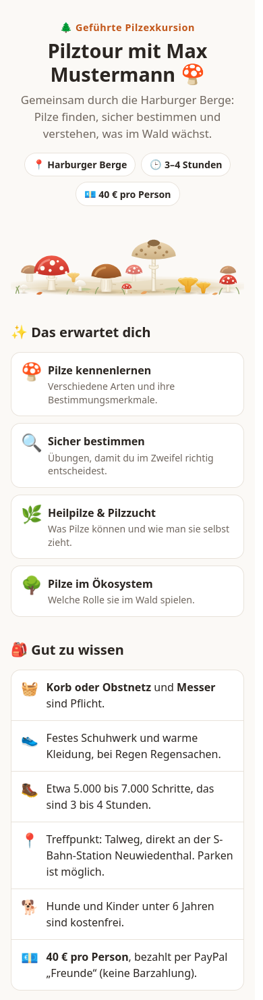
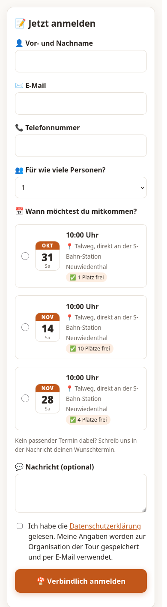
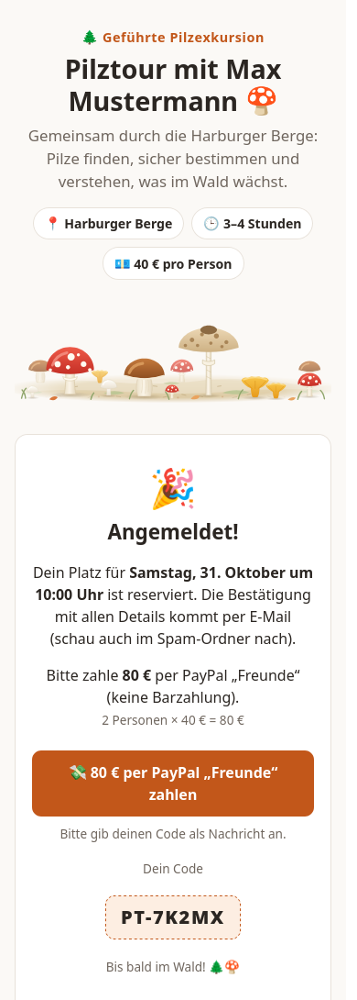
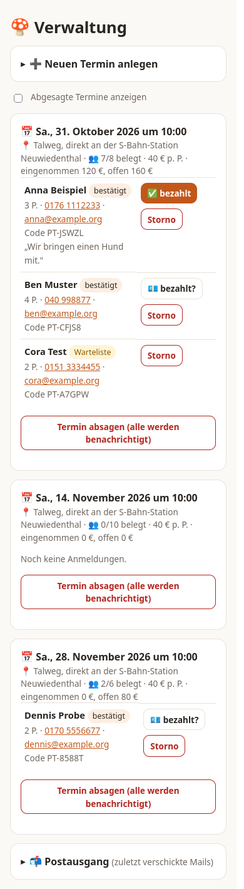
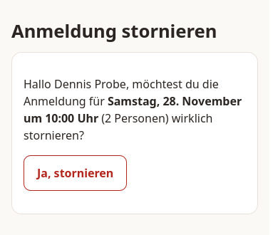
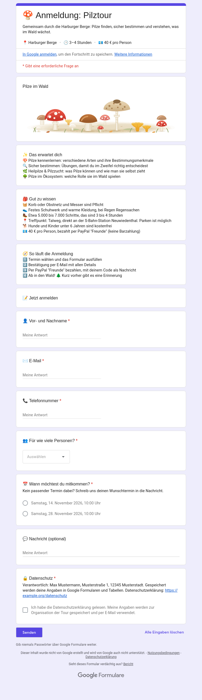

# Tourbuchung – Anmeldung und Verwaltung für Pilztouren

Kleine Web-App für geführte Pilztouren. Gäste melden sich selbst an, der Server bestätigt, erinnert und kümmert sich um Warteliste und Absagen. Der Veranstalter muss nur noch Termine anlegen und Zahlungen abhaken. Entstanden nach dem Vorbild des bisherigen Google-Formulars (dieselben Felder und Texte, aber ohne Barzahlung), unabhängig von TourPost.

## Vorschau

<table>
  <tr>
    <td align="center"><br><sub>Anmeldeseite</sub></td>
    <td align="center"><br><sub>Formular mit Terminen</sub></td>
    <td align="center"><br><sub>Bestätigung mit Code</sub></td>
    <td align="center"><br><sub>Verwaltung</sub></td>
    <td align="center"><br><sub>Stornolink aus der Mail</sub></td>
  </tr>
</table>

Die Bilder zeigen Beispieldaten (erfundene Namen), keine echten Gäste.

## So funktioniert es (kurz und einfach)

**Für die Gäste**
1. Sie öffnen die Seite und suchen sich einen **Termin** aus.
2. Sie tragen Name, E-Mail und Telefon ein und drücken auf „Anmelden".
3. Sie bekommen sofort eine **E-Mail** mit allen Infos und einem persönlichen **Code**.
4. Sie bezahlen per **PayPal „Freunde"** und schreiben den Code dazu.
5. Kurz vor der Tour kommt eine **Erinnerung**. Danach gibt es ein Dankeschön.

**Für den Veranstalter**
1. Er legt in der **Verwaltung** (`/admin/`) einen neuen Termin an: Datum, Treffpunkt, Plätze, Preis.
2. Ab da läuft fast alles von allein: Anmeldungen, Bestätigungen, Warteliste, Erinnerungen.
3. Er schaut ab und zu in PayPal, ob Geld da ist, und tippt in der Verwaltung beim Gast auf **„bezahlt?"**.
4. Muss eine Tour ausfallen, drückt er auf **„Termin absagen"**. Alle Angemeldeten bekommen eine Mail.

**So sieht der Ablauf aus**

```
Veranstalter legt Termin an
        │
        ▼
Gast meldet sich an ──► Mail mit Code ──► Gast zahlt per PayPal
        │                                        │
        │ (Tour voll?)                           ▼
        ▼                              Veranstalter tippt „bezahlt ✓"
   Warteliste ──► rückt nach, sobald                │
   ein Platz frei wird                              ▼
                        2 Tage vorher: Erinnerung ──► Tour ──► Danke-Mail
                                                                   │
                                                                   ▼
                                    nach 12 Monaten: persönliche Daten werden gelöscht
```

**Was der Veranstalter nie von Hand tun muss:** Bestätigungen schreiben, Erinnerungen schicken, die Warteliste pflegen, Zahlungs-Nachfragen stellen, alte Daten löschen.

**Was er noch selbst tun muss:** Termine anlegen, Zahlungen abhaken, bei Absagen auf den Knopf drücken, und PayPal im Blick behalten.

## Geplant: Zahlung automatisch erkennen (PayPal Checkout)

**Was es kostet** (Zahlen nicht geprüft, vor der Entscheidung bei PayPal nachsehen):
- Ein **PayPal-Geschäftskonto**, soweit bekannt ohne Grundgebühr.
- Pro Zahlung eine **Gebühr von etwa 3 % plus einem kleinen Festbetrag**, die der Veranstalter trägt. Bei 40 € sind das grob 1,50 €, bei 80 € (zwei Personen) grob 2,80 €. Die Gäste zahlen nichts extra.
- Im Vergleich: „Freunde" kostet nichts, ist aber für bezahlte Leistungen nicht erlaubt (kein Käuferschutz, Kontosperrung möglich).

**Was man dafür bekommt:**
- Der Gast zahlt direkt auf der Seite per PayPal-Knopf. PayPal meldet die Zahlung **sofort** an den Server, die Anmeldung wird **automatisch als bezahlt markiert**. Der Veranstalter muss nichts mehr in PayPal nachsehen und nichts mehr abhaken.
- Der Code muss nicht mehr von Hand als Nachricht eingetippt werden, die Zuordnung klappt von allein. Keine Verwechslungen, keine falschen Beträge.
- Die Zahlungserinnerungen verstummen automatisch, wenn bezahlt ist, und der Gast bekommt eine Zahlungsbestätigung.
- Rechtlich sauber, mit Käufer- und Verkäuferschutz.
- Rückerstattungen lassen sich später ebenfalls über PayPal anstoßen.

**Was dafür nötig ist:** Geschäftskonto mit einer App (Client-ID und Secret in die `.env`, nie in den Chat), eine öffentlich erreichbare HTTPS-Adresse für die Benachrichtigung von PayPal und etwas Entwicklungsaufwand. Testen geht in der PayPal-Sandbox ohne echtes Geld. Noch nicht gebaut, siehe auch den Abschnitt „Bezahlung".

## Was automatisch passiert

| Wann | Was |
|---|---|
| Anmeldung | Bestätigungsmail mit Treffpunkt, Ausrüstung, Preis, **Code** (`PT-XXXXX`) und Stornolink. Der Veranstalter bekommt eine Meldung. |
| Tour ausgebucht | Neue Anmeldungen kommen auf die **Warteliste**. Wird abgesagt, rückt der Nächste nach und bekommt sofort eine Mail. |
| 48 Stunden nach der Anmeldung | Zahlungserinnerung, falls noch nicht bezahlt. |
| 48 Stunden vorher | Erinnerung mit Checkliste, bei offener Zahlung mit Zahlungshinweis. |
| Tag nach der Tour | Dankesmail (mit Link zur Rückmeldung, falls gesetzt). Wer noch nicht bezahlt hat, wird freundlich erinnert. |
| 12 Monate nach der Tour (einstellbar, `LOESCHFRIST_MONATE`) | **Automatische Löschung**: Name, E-Mail, Telefon und Nachricht werden entfernt, ebenso die gespeicherten Mails. Stornierte Anmeldungen schon nach 30 Tagen. Code, Personenzahl, Termin und Zahlungsvermerk bleiben ohne Namen für die Buchhaltung. |
| Termin abgesagt | Mail an alle Angemeldeten mit dem Grund. |
| Gast storniert (Link in der Mail) | Bestätigung, Meldung an den Veranstalter, Warteliste rückt nach. |

## Bezahlung

**Nur per PayPal, keine Barzahlung.** Jede Anmeldung hat einen Code (`PT-XXXXX`), der Gast gibt ihn bei PayPal als Nachricht an. Der Link in den Mails enthält den Betrag. Der Veranstalter sieht die Zahlung in PayPal und tippt in der Verwaltung auf „bezahlt?". Offene Zahlungen werden automatisch nachgehalten: 48 Stunden nach der Anmeldung kommt eine Zahlungserinnerung, 48 Stunden vor der Tour die Erinnerung mit Zahlungshinweis, am Tag danach noch einmal ein Hinweis.

Wichtig zu wissen:
- PayPal erlaubt **„Freunde und Familie" nicht für bezahlte Leistungen**. Es gibt dabei keinen Käuferschutz, und PayPal kann das Konto einschränken. Ob bezahlt wurde, lässt sich für „Freunde" nicht automatisch erkennen (keine Schnittstelle), deshalb der Handabgleich.
- Da jetzt jeder online zahlen muss, ist **PayPal Checkout** (Geschäftskonto, ca. 2,99 % + 0,35 € pro Zahlung) die saubere Lösung. Die Anmeldung würde dann bei Zahlung automatisch als bezahlt markiert, und der Handabgleich entfällt. Das ist noch nicht gebaut.
- Offen: Ob unbezahlte Plätze nach einer Frist automatisch wieder freigegeben werden sollen, ist noch nicht entschieden und nicht gebaut.

## Starten

```bash
npm install
cp .env.example .env      # ADMIN_PASSWORD, KONTAKT_EMAIL, BASE_URL, PAYPAL_ME, SMTP_* ausfüllen
npm start                 # http://localhost:3200
npm test                  # Ablauf-Tests gegen eine Wegwerf-Datenbank
```

- **Gäste:** `/` (Anmeldung), `/storno/<Token>` (aus der Mail).
- **Verwaltung:** `/admin/`, Benutzername beliebig, Passwort aus `ADMIN_PASSWORD`. Dort: Termine anlegen und absagen, Anmeldungen sehen, Zahlungen abhaken, Gäste stornieren, Postausgang ansehen.
- **Mails:** Ohne `SMTP_HOST` werden Mails nur im Postausgang der Verwaltung gespeichert (Testmodus). Für den echten Betrieb SMTP eintragen (z. B. ein Mail-Konto des Veranstalters mit App-Passwort oder ein Dienst wie Brevo/Mailjet).
- **Löschwunsch** eines Gastes: In der Verwaltung bei vergangenen Touren auf „Daten löschen" tippen (bei künftigen Touren erst stornieren).
- Daten liegen in `data/tourbuchung.db` (SQLite, nicht im Repo, regelmäßig sichern).
- Termine sind Ortszeit (`TZ=Europe/Berlin`).

## Betrieb auf einem gemieteten Server

Läuft auf einem kleinen Server (z. B. 3 bis 5 € im Monat) hinter einem Reverse-Proxy mit **HTTPS**, zum Beispiel Caddy:

```
pilz.deinedomain.de {
    reverse_proxy 127.0.0.1:3200
}
```

Als systemd-Dienst starten (`ExecStart=/usr/bin/node server/index.js`, `WorkingDirectory` auf den Projektordner, `Restart=on-failure`). Ohne HTTPS darf die Verwaltung nicht benutzt werden, das Passwort wird sonst im Klartext übertragen. `BASE_URL` muss die öffentliche Adresse sein, sonst stimmen die Links in den Mails nicht.

## Betrieb auf dem Heimserver (günstig)

Der Server läuft auf einem Rechner zu Hause (Raspberry Pi, Mini-PC, alter Laptop) und wird über einen **Cloudflare-Tunnel** erreichbar gemacht. Kosten: nur Strom und eine **Domain** (grob 5 bis 15 € im Jahr, nicht geprüft). Eine Portfreigabe im Router ist nicht nötig, der Tunnel baut die Verbindung nach außen auf.

**Vorher wissen:**
- Die Seite ist nur erreichbar, solange Rechner und Internet laufen. Standby und Ruhezustand ausschalten. Für ein Angebot, bei dem Geld fließt, ist ein gemieteter Server zuverlässiger. Der Umzug ist einfach: Projektordner und `data/tourbuchung.db` mitnehmen.
- Der Schnelltunnel (`trycloudflare.com`, wie bei TourPost) taugt hier **nicht**: Die Adresse ändert sich bei jedem Start, aber Gäste, Stornolinks in Mails und PayPal brauchen eine feste Adresse.
- Namen, Mailadressen und Telefonnummern der Gäste liegen auf einem privaten Rechner. Das gehört in die Datenschutzerklärung, und der Rechner braucht Updates und ein sicheres Passwort.
- Der Tunnel darf **nur** auf die Tourbuchung (Port 3200) zeigen, nie auf andere Dienste desselben Rechners.

**1. Domain und Cloudflare-Konto**
1. Kostenloses Konto auf [cloudflare.com](https://www.cloudflare.com) anlegen.
2. Eine Domain besorgen (bei Cloudflare direkt oder bei einem anderen Anbieter) und in Cloudflare unter „Domain hinzufügen" eintragen. Bei einem anderen Anbieter dort die **Nameserver** auf die von Cloudflare umstellen. Das dauert bis zu einige Stunden.

**2. Tourbuchung einrichten**
```bash
git clone https://github.com/R13N3K3/tourbuchung.git
cd tourbuchung
npm install
cp .env.example .env
```
In der `.env` mindestens ausfüllen: `ADMIN_PASSWORD` (lang und zufällig), `BASE_URL=https://buchung.deinedomain.de`, `KONTAKT_EMAIL`, `PAYPAL_ME` und die `SMTP_*`-Daten. `HOST` bleibt auf `127.0.0.1`, der Server ist dann nur über den Tunnel erreichbar.

**3. Tunnel anlegen** (Beispiel mit der Adresse `buchung.deinedomain.de`)
```bash
sudo pacman -S cloudflared          # Arch/CachyOS, sonst siehe Cloudflare-Downloadseite
cloudflared tunnel login            # Browser öffnet sich, Domain auswählen
cloudflared tunnel create tourbuchung
cloudflared tunnel route dns tourbuchung buchung.deinedomain.de
```
`create` gibt eine **Tunnel-ID** aus (und legt `~/.cloudflared/<ID>.json` an, das ist ein Geheimnis, nie weitergeben). Dann die Datei `~/.cloudflared/config.yml` anlegen:
```yaml
tunnel: <Tunnel-ID>
credentials-file: /home/<benutzer>/.cloudflared/<Tunnel-ID>.json
ingress:
  - hostname: buchung.deinedomain.de
    service: http://127.0.0.1:3200
  - service: http_status:404
```

**4. Beides als Dienste starten, damit es immer läuft**

Server: `~/.config/systemd/user/tourbuchung.service`
```ini
[Unit]
Description=Tourbuchung
After=network-online.target

[Service]
WorkingDirectory=/home/<benutzer>/tourbuchung
ExecStart=/usr/bin/node server/index.js
Restart=on-failure
RestartSec=5

[Install]
WantedBy=default.target
```
Tunnel: `~/.config/systemd/user/cloudflared-tourbuchung.service`
```ini
[Unit]
Description=Cloudflare Tunnel für Tourbuchung
After=network-online.target

[Service]
ExecStart=/usr/bin/cloudflared tunnel --no-autoupdate run tourbuchung
Restart=on-failure
RestartSec=5

[Install]
WantedBy=default.target
```
Dann aktivieren und dafür sorgen, dass sie auch ohne Anmeldung nach einem Neustart laufen:
```bash
systemctl --user daemon-reload
systemctl --user enable --now tourbuchung cloudflared-tourbuchung
sudo loginctl enable-linger $USER
```
(Den Pfad zu `node` und `cloudflared` mit `command -v node` bzw. `command -v cloudflared` prüfen und einsetzen.) Logs: `journalctl --user -u tourbuchung -f`.

**5. Prüfen**
- `https://buchung.deinedomain.de` zeigt die Anmeldeseite, `/admin/` fragt nach dem Passwort.
- Eine Testanmeldung machen und prüfen, dass die Mail ankommt, die Links darin die richtige Adresse haben und der Stornolink funktioniert.
- Rechner neu starten und prüfen, dass alles von allein wieder läuft.

**6. Sicherung der Daten** (die Datenbank enthält die Gästedaten, Sicherungen sind genauso vertraulich)
```bash
sudo pacman -S sqlite
mkdir -p ~/tourbuchung-backup
# täglich um 3 Uhr (crontab -e):
0 3 * * * sqlite3 ~/tourbuchung/data/tourbuchung.db ".backup '$HOME/tourbuchung-backup/db-$(date +\%F).db'" && find ~/tourbuchung-backup -name 'db-*.db' -mtime +30 -delete
```
Sicherungen nach 30 Tagen zu löschen passt zur Löschfrist der Datenschutzerklärung. Eine Kopie auf einem zweiten Datenträger lohnt sich.

**Tipp zur Verwaltung:** `/admin/` ist über das Internet erreichbar und nur durch das Passwort geschützt. Wer mehr Schutz will, kann in Cloudflare (Zero Trust, „Access") den Pfad `/admin*` zusätzlich per Anmeldung absichern. Das ist im kostenlosen Tarif für wenige Nutzer möglich, die Details ändern sich bei Cloudflare öfter.

## Variante ohne eigenen Server: Google Forms

Wer keinen Server betreiben will, kann das Formular als **Google Formular** anlegen. Das Skript `docs/google-forms/formular-erstellen.gs` baut es mit denselben Feldern, Abschnitten (Das erwartet dich, Gut zu wissen, So läuft die Anmeldung), Emojis und Kopfbild wie die Anmeldeseite, dazu eine Tabelle für die Antworten.

<p align="center"><br><sub>Das vom Skript erzeugte Formular (echter Screenshot, mit Beispieldaten für Verantwortlichen und Datenschutz-Link). Farben und Hintergrund lassen sich in Google über die Farbpalette (Design anpassen) auf Orange und Creme umstellen.</sub></p>

**Einrichtung (einmal, ca. 5 Minuten):**
1. Auf [script.google.com](https://script.google.com) mit dem Google-Konto des Veranstalters ein **neues Projekt** anlegen.
2. Den Inhalt von `formular-erstellen.gs` einfügen. Oben unter `CONFIG` Name, Kontakt-Mail, PayPal.me-Name, Verantwortlichen, Adresse der Datenschutzerklärung und die Termine eintragen (nur in der eigenen Kopie bei Google, nicht im Repository).
3. Die Funktion **`formularErstellen`** ausführen und die Berechtigungen bestätigen (Formulare, Tabellen, E-Mail, Trigger).
4. Im **Ausführungsprotokoll** stehen danach die Links: Formular zum Teilen, Formular bearbeiten, Antworten-Tabelle.
5. **Neu erstellen:** Vorher die Funktion **`aufraeumen`** ausführen (löscht die alten Trigger) und das alte Formular und die alte Tabelle in Google Drive löschen, sonst gehen die Mails doppelt raus.

**Was automatisch läuft:**
- Bei jeder Anmeldung eine **Bestätigungsmail** mit Code, Treffpunkt, Ausrüstung und Zahlungshinweis. Der Veranstalter bekommt eine Meldung.
- **Plätze:** Pro Termin zählt das Skript die bestätigten Personen. Ist der Termin voll, kommen weitere Anmeldungen auf die **Warteliste** (mit entsprechender Mail), und der Termin verschwindet aus dem Formular.
- Täglich um 9 Uhr eine **Erinnerung** an alle, deren Tour in den nächsten 48 Stunden stattfindet, bei offener Zahlung mit Hinweis.
- Zahlungen hakt der Veranstalter in der Tabelle in der Spalte **Bezahlt** mit `ja` ab.

**Datenschutzerklärung (Pflicht):** Für diese Variante gibt es einen eigenen Entwurf: [`docs/google-forms/datenschutzerklaerung-google-forms.md`](docs/google-forms/datenschutzerklaerung-google-forms.md). Er unterscheidet sich von der Web-App, weil die Daten bei Google liegen, die Mails über Google laufen und es **keine automatische Löschung** gibt (die Tabelle muss nach der Frist von Hand geleert werden). Platzhalter ausfüllen, rechtlich prüfen lassen, ohne eigene Webseite als Google Dokument im Web veröffentlichen und den Link in `CONFIG.datenschutzUrl` eintragen. Zusätzlich braucht es mit Google einen Auftragsverarbeitungsvertrag (bei Google Workspace in der Admin-Konsole, bei einem rein privaten Konto nach meinem Kenntnisstand nicht möglich, bitte klären). Das Formular zeigt unter „🔒 Datenschutz" den Verantwortlichen und den Link an, das Skript warnt im Protokoll, wenn sie fehlen.

**Datenschutzerklärung veröffentlichen (Schritt für Schritt):**
1. Neues **Google Dokument** anlegen (`docs.new`) und den Text aus `docs/google-forms/datenschutzerklaerung-google-forms.md` hineinkopieren. Alles in `[[…]]` ausfüllen, die Hinweise für den Veranstalter und den roten Entwurfskasten löschen.
2. Im Dokument **Datei → Teilen → Im Web veröffentlichen → Veröffentlichen** wählen und den Link kopieren.
3. Im Skript `datenschutzUrl` auf diesen Link setzen und `verantwortlicher` mit Name und Anschrift füllen.
4. Formular neu erzeugen: `aufraeumen` ausführen, altes Formular und alte Tabelle in Drive löschen, `formularErstellen` ausführen. (Alternativ im bestehenden Formular den Hilfetext der Frage „🔒 Datenschutz" von Hand ändern, dann steht der Link aber nicht im Skript.)
5. Die Anschrift des Veranstalters gehört **nicht** in Dateien im Repository, nur in die eigene Kopie bei Google.

**Was es dort nicht gibt** (nur in der Web-App): Stornolink, automatisches Nachrücken von der Warteliste, die Verwaltungsseite, Zahlungserinnerung, Dankesmail, Termine ohne Skriptänderung anlegen, automatische Löschung nach der Frist. Außerdem liegen die Daten bei Google, das gehört in die Datenschutzerklärung, und Impressum und Datenschutzerklärung braucht es auch hier. Das Skript ist nach der Doku geschrieben und **noch nicht in einem echten Google-Konto ausprobiert**, nur auf Syntax geprüft. Die Menünamen bei Google ändern sich, im Zweifel sinngemäß suchen.

## Datenschutzerklärung und Impressum der Web-App ausfüllen

Die beiden Seiten liegen als Entwurf in `public/datenschutz.html` und `public/impressum.html`. Sie unterscheiden sich von der Erklärung für die Google-Variante, weil die Web-App auf einem eigenen Server läuft und alte Daten automatisch löscht.
1. Beide Dateien öffnen und alle **gelb markierten** Stellen (`class="ph"`) ausfüllen: Verantwortlicher, Anschrift, E-Mail, Hoster, Mail-Anbieter, Fristen, Aufsichtsbehörde, Datum.
2. Die Löschfrist muss zu `LOESCHFRIST_MONATE` in der `.env` passen (Standard 12 Monate, stornierte Anmeldungen nach 30 Tagen).
3. Die roten **ENTWURF**-Hinweise oben auf beiden Seiten entfernen, wenn alles stimmt und rechtlich geprüft ist.
4. Server neu starten. Die Seiten sind dann unter `/datenschutz.html` und `/impressum.html` erreichbar und im Formular verlinkt.
5. Die echten Angaben nur in einem **privaten** Repository oder auf dem Server speichern, nicht in einem öffentlichen.

## Vor dem Start erledigen

- **Impressum und Datenschutzerklärung** (`public/impressum.html`, `public/datenschutz.html`) sind nur Platzhalter. Sie müssen vom Veranstalter ausgefüllt und geprüft werden, die Seite speichert Namen, E-Mail und Telefonnummern.
- Steuerliche Behandlung der Einnahmen klären (gewerblich oder nicht).
- Mail-Zugang einrichten und eine Testanmeldung machen.

## Noch nicht gebaut

- PayPal Checkout mit automatischer Zahlungserkennung
- WhatsApp-Bestätigung (geht nur über die WhatsApp-Business-API von Meta, kostet pro Nachricht)
- Wetter-Absage-Vorschlag, Gutscheine, mehrere Touren-Arten
- Rückerstattungen werden von Hand abgewickelt

## Aufbau

```
server/   index.js (Routen), buchung.js (Anmeldung, Warteliste, Storno), jobs.js (Erinnerungen), mails.js (Texte), mail.js (Versand), db.js
public/   Anmeldeseite, Stornoseite, Impressum, Datenschutz
admin/    Verwaltung
test/     Ablauftests
```
